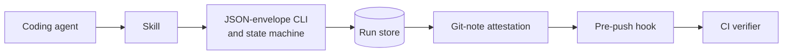

# agentic-preflight

[](https://github.com/elanthus/agentic-preflight/actions/workflows/ci.yml)
[](https://github.com/elanthus/agentic-preflight/tree/badges)
[](https://github.com/elanthus/agentic-preflight/blob/v0.8.1/pyproject.toml)
[](https://github.com/elanthus/agentic-preflight/blob/v0.8.1/LICENSE)

**Check your coding agent's work before a push.**

Agentic Preflight checks a coding agent's work before the agent pushes a commit.
It works with Codex, Claude Code, Cursor, OpenCode, and Amp.
It guides your coding agent through review, documentation, lint, and test stages.
It records the results for the exact commit.
The pre-push hook blocks a normal push if this evidence is missing or no longer valid.

- **Use your current agent.** The core CLI calls no model and needs no model API key.
- **Inspect each stage.** The run record includes skipped stages, failures, findings, and approvals.
- **Keep results with their inputs.** A changed commit, configuration, or intent cannot use unrelated evidence.

The [dogfooding case study](docs/dogfooding-case-study.md) found the same failure in three
independent codebases: a green result stayed valid after an input that shaped it changed.
Green evidence must bind every decision-making input, including code, configuration,
intent, model, and prompts. The study also describes the limits of its evidence.


## The problem

A coding agent that reports "tests passed" may be describing a different revision, a different configuration, or a different intent from the commit it is about to push.
Nothing in a normal push connects that claim to the exact inputs that produced it.
Agentic Preflight records each result with a fingerprint of those inputs and refuses the push when they no longer match.

## How it fits together



## Design highlights

- [Fingerprint contract](docs/fingerprint-contract.md): which inputs a result is bound to, and what invalidates it.
- [Context grounding](docs/context-grounding.md): how review is tied to the repository's own facts.
- [State machine](docs/state-machine.md): the stages, transitions, and when a run may publish.
- [Regression eval](docs/regression-eval.md): the scripted cases that guard workflow behavior.

## Quickstart

You need Git 2.38+, Python 3.11 through 3.13, and
[`uv`](https://docs.astral.sh/uv/getting-started/installation/).

1. Install the CLI and the integrations for your coding agents:

   ```bash
   uv tool install agentic-preflight
   agentic-preflight integrations install codex claude cursor opencode amp
   ```

   Remove unused integration names from the command.

2. Initialize each repository that you want to protect:

   ```bash
   cd your-repo
   agentic-preflight init
   git add .agentic-preflight.toml
   git commit -m "Configure Agentic Preflight"
   ```

   `init` writes a configuration file with comments and installs an advisory pre-push hook.
   Pass `--no-hook` to write only the configuration file.

3. Review the generated configuration before you start a run.

   Setup, lint, test, and optional command-review entries execute with your user privileges.

4. Make and commit your product change.

5. Ask your coding agent to invoke `$agentic-preflight` in Codex or `/agentic-preflight` in Claude Code.

   The installed skill controls the run and presents findings.
   It follows each command that the CLI returns.

The hook stops a push if the changed commit has not passed its run.
The hook tells you how to start or resume verification.
After the run passes, the agent shows the target remote, branch, commits, and risk.

The agent pushes only with your request or permission from your standing instructions.
See [push and pull-request authorization](https://github.com/elanthus/agentic-preflight/blob/v0.8.1/docs/configuration.md#push-and-pull-request-authorization).
Set `[gate] mode = "manual"` if only a person must run the final Git command.

The [installation guide](https://github.com/elanthus/agentic-preflight/blob/v0.8.1/docs/installation.md)
includes source installations, upgrades, project skills, other Agent Skills clients, and removal.

## What Agentic Preflight adds

Agentic Preflight works with prompts, ordinary Git hooks, hosted CI, and human review.
It does not replace these checks.

A prompt can ask an agent to review work and run tests.
The conversation does not bind those results to a commit.
Ordinary hooks run deterministic commands. Hosted CI validates code after publication.

Agentic Preflight puts these checks in an ordered workflow before a push.
It records the results for the commit that passed. You can resume an interrupted workflow.

These records help in the following conditions:

- An agent reports a successful command from an earlier revision.
- A fix changes code after review or testing.
- Repository policy requires documentation review or independent review.
- A rebase changes the commit identity.
- A high-risk path requires a specified human-approval mode.

Agentic Preflight is advisory. It shows missing or invalid evidence in the normal workflow.
It is not a security boundary. A person can bypass the local hook with `git push --no-verify`.

## What happens during a run

Agentic Preflight moves the change through this workflow:

```text
review -> documentation -> lint -> test -> merge-back -> gate -> push
```

At the start, the agent supplies your objective and acceptance criteria.
If `origin` exists, Agentic Preflight fetches it.
It rebases the validation worktree onto the current base before review.
If a rebase would change the content that the branch introduces, it merges the base instead.
Each agent-facing workflow command returns one JSON object with the next permitted command.
This recorded state lets an interrupted run resume.

Each stage has a specified purpose:

- **Review** lists changed hunks and non-text files.
  The reviewer must account for the complete snapshot.
  The record keeps findings and their dispositions.
- **Documentation** checks configured documents for claims that the change makes incorrect.
- **Lint and test** run configured commands and record exit codes and output hashes.
  Changes that affect only documentation or CI configuration skip the software test command.
  An explicit transition records the skip.
  Applicable tests complete locally before publication. Hosted CI separately validates the proposed integration.
- **Merge-back and approval** check that reviewed content matches the source branch.
  They calculate risk from repository policy and findings. They show the publication target.
- **Push** publishes the branch and its Git-note attestation in one atomic operation.
  An attestation is a record of the checks for a commit.
  Automatic PR mode lets the agent create or reuse a GitHub pull request and monitor its checks.
  Manual PR mode returns a compare URL.

A rebase with equivalent content can reuse review and documentation evidence if its inputs still match.
Applicable lint and test stages run again in each new run, even for identical trees.
Keep the producer and protected verifier on the same version.
See the [fingerprint contract](https://github.com/elanthus/agentic-preflight/blob/v0.8.1/docs/fingerprint-contract.md).

Pull-request merge polling and cleanup after merge are disabled by default.
Set `[pr] automated_cleanup = true` to enable them.

Run `agentic-preflight status` in the source worktree to inspect or resume its run.
Use `agentic-preflight status --all` to list runs across linked worktrees.

## Configure repository policy

Commit `.agentic-preflight.toml` at the repository root.
Each section replaces the complete matching section in the user configuration, `~/.config/agentic-preflight/config.toml`.
Use the file to set these options:

- Protected base branch and lint/test commands
- Blocking finding severities and independent command-review policy
- Documentation paths and generated-file exclusions
- Path-based risk and required human-approval mode
- In-place, reusable, or strict validation worktrees
- Automatic or manual push and pull-request behavior

Unknown keys cause errors.
The retired `[ci]` and `[reuse]` sections cause a warning and have no effect.

When you upgrade from 0.6.0, remove those sections and `[hook] enabled`.
See the [0.7 upgrade guide](https://github.com/elanthus/agentic-preflight/blob/v0.8.1/docs/upgrade-0.7.md).
Commit configuration changes before you start the affected run.
Each run saves its resolved configuration.
The [configuration reference](https://github.com/elanthus/agentic-preflight/blob/v0.8.1/docs/configuration.md)
lists all options and gives a complete example.

> **Warning:** Repository commands execute with your privileges.
> These commands can include setup, lint, test, and independent review.
> Run Agentic Preflight only where you are willing to execute the repository's code and build commands.

## Choose a validation worktree

The default `in_place` mode validates the current checkout.
Use a clean worktree with one agent and one pull request.
This mode can reuse dependencies installed in that checkout.

Set `[worktree] mode` to `reusable` or `strict` to validate without changes to the source checkout.
Isolated validation worktrees do not inherit `.venv`, `node_modules`, `.env`, or other ignored files.
Configure `setup_command` to install dependencies. Configure `copy_files` for required ignored files.
The [worktree-modes guide](https://github.com/elanthus/agentic-preflight/blob/v0.8.1/docs/worktree-modes.md)
explains mode selection, concurrent runs, secrets, and recovery.

## Enforce attestations in CI

A successful merge-back writes a versioned JSON attestation as a Git note on the exact commit.
The attestation records review coverage, finding dispositions, stage results, and policy.
It also records inputs used to check whether evidence remains valid after a history rewrite.

The local hook checks the commit for the push.
A GitHub workflow from the protected base can also verify the attestation.
It can enforce the configured high-risk approval mode before merge.
This requires forge configuration. A committed `.agentic-preflight.toml` file alone does not change branch protection.
See [Portable attestations and CI enforcement](https://github.com/elanthus/agentic-preflight/blob/v0.8.1/docs/attestations-and-ci.md)
for setup and verification commands.

## Architecture, evaluation, and evidence

Design records, executable tests, and published evaluations support this workflow.
Use this table to find more information:

| Question | Design or evidence |
|---|---|
| How does this workflow compare with its inspiration? | [Prior art and differentiation](https://github.com/elanthus/agentic-preflight/blob/v0.8.1/docs/prior-art.md) |
| Where does responsibility pass between the coding agent, CLI, and shell commands? | [ADR 0001: orchestration boundaries](https://github.com/elanthus/agentic-preflight/blob/v0.8.1/docs/adr/0001-orchestration-boundaries.md) |
| How can linked worktrees run independently and safely? | [ADR 0002: worktree-scoped run ownership](https://github.com/elanthus/agentic-preflight/blob/v0.8.1/docs/adr/0002-scope-run-ownership-to-worktrees.md) |
| What repository context reaches review, and how is untrusted content bounded? | [Grounded context](https://github.com/elanthus/agentic-preflight/blob/v0.8.1/docs/context-grounding.md) |
| When can evidence survive a rebase or restack? | [Fingerprint contract](https://github.com/elanthus/agentic-preflight/blob/v0.8.1/docs/fingerprint-contract.md) |
| How are attestations enforced in CI? | [CI enforcement](https://github.com/elanthus/agentic-preflight/blob/v0.8.1/docs/attestations-and-ci.md) |
| What does a second reviewer add, and how are reviewers compared? | [Independent review and agreement](https://github.com/elanthus/agentic-preflight/blob/v0.8.1/docs/independent-review.md) |
| What public evidence supports the project, and what does it not prove? | [Dogfooding case study](https://github.com/elanthus/agentic-preflight/blob/v0.8.1/docs/dogfooding-case-study.md) and [public regression eval](https://github.com/elanthus/agentic-preflight/blob/v0.8.1/docs/regression-eval.md) |
| Where are the pre-registered evaluation results and the immutable evidence ledgers published? | [elanthus/preflight-eval-results](https://github.com/elanthus/preflight-eval-results) |
| What did real Claude and Codex smoke runs measure? | [Opus 5.5 and GPT-6.1 Sol at low effort: runtime, findings, states, and tokens (2026-10-17)](https://github.com/elanthus/agentic-preflight/blob/v0.8.1/docs/evals/2026-10-17-opus-sol-low/README.md) |
| What does the tool record about my own runs, and where? | [Local run telemetry](https://github.com/elanthus/agentic-preflight/blob/v0.8.1/docs/local-telemetry.md) |
| How do I summarize my runs across repositories? | [Read the report](https://github.com/elanthus/agentic-preflight/blob/v0.8.1/docs/local-telemetry.md#read-the-report) |
| Which pushes did the pre-push hook allow or block, and why? | [Hook decisions](https://github.com/elanthus/agentic-preflight/blob/v0.8.1/docs/local-telemetry.md#hook-decisions) |

Integration tests use real Git repositories. They do not simulate Git behavior.
CI rejects overall test coverage below 85%.
It also installs the built wheel as a `uv` tool before it invokes the CLI.
The [contributor guide](https://github.com/elanthus/agentic-preflight/blob/v0.8.1/CONTRIBUTING.md)
describes local development.

## Limits

**Agentic Preflight is an advisory pre-push check. It is not a security boundary.**

- A person can bypass the local hook with `git push --no-verify`.
- The push-confirmation token is not a secret.
  It prevents an accidental tool-driven push.
  It does not stop an agent with shell access from a direct Git invocation.
- An attestation proves what the configured stages reported.
  It does not prove that the reviewer understood the change.
  It does not replace hosted CI or human review.
- Git notes can change.
  Anyone with permission to update the notes ref can replace an attestation.

Set `[gate] mode = "manual"` if the CLI must refuse to perform the final push.
Read the [limits guide](https://github.com/elanthus/agentic-preflight/blob/v0.8.1/docs/limits.md)
before you use attestations or evidence reuse to enforce policy.

## Requirements

- A supported macOS, Linux, or Windows and Python combination from the
  [compatibility policy](https://github.com/elanthus/agentic-preflight/blob/v0.8.1/COMPATIBILITY.md)
- Git 2.38+
- A POSIX shell if a configured command needs shell interpretation or its program cannot be resolved directly
- `gh` if the agent will create pull requests, inspect hosted checks, or verify merges

Git for Windows supplies a POSIX shell on Windows.

## Help and development

Use the [support guide](https://github.com/elanthus/agentic-preflight/blob/v0.8.1/SUPPORT.md)
for help and security reports.
Contributors should start with the
[contributor guide](https://github.com/elanthus/agentic-preflight/blob/v0.8.1/CONTRIBUTING.md).

Agentic Preflight uses the Apache 2.0 license.
[@elanthus](https://github.com/elanthus) created it with development contributions from OpenAI Codex and Anthropic Claude.
